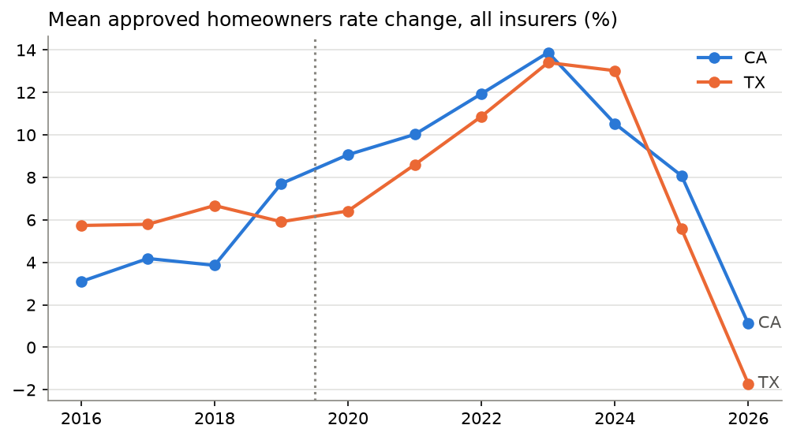

# Homeowners Rate Filings

<a target="_blank" href="https://cookiecutter-data-science.drivendata.org/">
    
</a>

How do the **10 largest homeowners insurers** (State Farm, Allstate, USAA, Liberty Mutual, Farmers,
Travelers, American Family, Nationwide, Chubb, Erie) file rates across states, how does each state's
**regulatory regime** (prior approval, file and use, use and file) shape **rejections and time to
approval**, how did this change **before vs after COVID**, and is rate activity connected to
**disasters and the housing market**? The project pulls public regulator data, builds analysis tables,
fits simple statistical models and presents everything in an interactive **Streamlit dashboard**.



## Quick start

```bash
python3.11 -m venv .venv && source .venv/bin/activate
make requirements      # install dependencies (+ this package in editable mode)
make pipeline          # download → clean → features → models → figures
make dashboard         # open http://localhost:8501
```

No API keys are needed. Raw downloads are cached in `data/raw/`. The first run includes a ~30-minute
crawl of California public notices (3 s between requests); it saves progress weekly and resumes if
interrupted. Pass `--force` to `python -m ho_rate_filings.dataset download` to refresh everything.

## Headline findings (filings received 2016 – Oct 2026)

| Question | Finding |
|---|---|
| Regimes | Per FIO/NAIC, **24 jurisdictions are file and use** (23 states + DC), **15 prior approval**, **10 use and file**; Alaska (flex band) and Wyoming (open rating) fit none of the three. |
| Time to approval | Top-10 rate filings: median **228 days in California** (prior approval) vs **95 days in Florida** (file and use). California's post-2020 median of **309 days** matches GAO's independent 305-day figure for 2020–24. |
| Rejections | Outright disapprovals are rare: **0% CA, 0.4% FL, 1.6% TX** of dispositioned top-10 rate filings. Counting withdrawals (often negotiated rejections): **8% CA, 14% FL, 3% TX**. In California **25%** of approved top-10 filings got less than requested (mean 8.5% requested → 7.2% approved). |
| Pre vs post COVID | Mean approved change for top-10 groups rose from **4.6% to 10.2% in CA** and **6.1% to 8.2% in TX** (all insurers TX: 6.0% → 10.7%); Chow tests find a break at 2020 in both states (p ≤ 0.002). California approval times **doubled (155 → 309 days)**, Florida's rose 77 → 107. California filing volume fell as insurers paused new business. |
| Disasters | Each extra **$100 of storm property damage per resident** in the prior year goes with a **+0.24-point** larger approved rate change (CA + TX, p = 0.01, state and group fixed effects). Across all 51 jurisdictions (FIO 2018–22), damage drives same-year **loss ratios** (+0.09 per $1,000/resident, p < 0.001) and next-year **premium growth** (+0.9 points per $1,000/resident, p = 0.04). |
| Housing / costs | Approved changes stepped up by **~5 points after 2020** even after controlling for disasters — the period when construction input prices rose ~17% a year (2021–22) and home values surged. Year-by-year construction-price growth is not separately significant because it moves almost one-for-one with the post-2020 shift; prior-year house-price growth is borderline (p ≈ 0.06–0.08). |
| Regime vs outcomes | In the FIO panel, regime has **no detectable effect** on premium growth, loss ratios or non-renewals once disasters are controlled for. Regulation changes **timing and size of increments**, not the direction. |
| News cross-check | Of 11 rate changes reported in the press (SF Chronicle/Sac Bee, CBS, ABC7, Insurance Business, Newsweek, S&P Global), **10 match the regulator data exactly** — e.g. State Farm CA 28.1% asked → 20.0% approved (Dec 2023), 17% emergency increase (2025); Allstate CA 34.1% (Aug 2024); USAA's four CA companies 16.8–30.6%; Farmers CA 7.0% → 1.5% (2026); Allstate TX 24.1% and State Farm Lloyds 7.6% (2023). The one difference is explained: the 38% State Farm rental-dwelling figure was the 2025 interim rate; the filing closed at 32.8%. |
| Market pullbacks | California's largest writers stopped or limited new business one after another — Chubb (Oct 2021), Allstate (Nov 2022), USAA Casualty (Apr 2023), State Farm (May 2023, still paused), Farmers' 7,000/month cap (Jul 2023), Nationwide's Crestbrook exit (Dec 2023 → Jun 2025), State Farm's ~30,000 non-renewals (Jul 2024). The biggest approved increases (20–34%) came **after** the pauses: e.g. USAA averaged 2.3% approved in the two years before its pause vs 19.8% after; State Farm 6.9% → 15.7%. Farmers lifted its cap in Nov 2025 after the Sustainable Insurance Strategy. In Florida, Farmers withdrew its own brand (Jul 2023) while statewide increases fell from ~9.6% (2023) to ~1% (2024–25). |

These are associations in observational data, not causal effects. State-level results are ecological.

## Data sources

| Topic | Source | Coverage | Fields |
|---|---|---|---|
| Regime by state | Federal Insurance Office, [*Analyses of U.S. Homeowners Insurance Markets 2018-2022*](https://home.treasury.gov/system/files/311/Analyses_of_US_Homeowners_Insurance_Markets_2018-2022_Climate-Related_Risks_and_Other_Factors_0.pdf) App. A.4 (from NAIC PA-10, 2022) | 51 | Regime, notes |
| Texas filings | TDI [Property & Casualty Rate Filings](https://data.texas.gov/dataset/Property-Casualty-Rate-Filings/ittv-5xew) (open data) | TX | % change, Reviewed / Rejected / Withdrawn, received date |
| Florida filings | FLOIR [IRFS search](https://irfssearch.floir.gov/) | FL | Dates filed & closed, final action, NAIC group |
| California filings | CDI [rate filing approvals](https://www.insurance.ca.gov/0250-insurers/0800-rate-filings/0100-rate-filing-lists/rate-filing-approvals/) (2016–18 via Internet Archive) + [WARFF](https://interactive.web.insurance.ca.gov/apex_extprd/f?p=186) public notices | CA | Requested & approved %, status, closed date, notice (≈ received) date |
| Approval-time benchmark | [GAO-26-107867](https://files.gao.gov/reports/GAO-26-107867/index.html) fig. 4 | 51 (binned) | Median days 2020–24 |
| Premiums, loss ratios, non-renewals | FIO ZIP-level metrics 2018–22 ([re-hosted by CFA](https://consumerfed.org/)) | 51 | Median across ZIPs |
| News reports & market pullbacks | Hand-curated from news coverage, one source link per row (`ho_rate_filings/reference/news.py`) | CA, TX, FL, NC | Reported requested/approved %, pauses, caps, non-renewals, exits |
| Disasters | NOAA [Storm Events](https://www.ncei.noaa.gov/pub/data/swdi/stormevents/csvfiles/), [OpenFEMA](https://www.fema.gov/about/openfema/data-sets) | 51 | Property damage by peril, major declarations, assistance |
| Housing & macro | [FHFA HPI](https://www.fhfa.gov/data/hpi), FRED (mortgage rate, PPI residential construction inputs, CPI shelter & household insurance, state population & homeownership) | 51 | |

### Why filing-level data cover only CA, FL and TX

Most states publish filings through **SERFF Filing Access**, whose terms of use prohibit automated
downloads; the NAIC, AM Best (RateFilings.com) and S&P datasets are paid. California, Florida and Texas
publish filing lists themselves. They are the three largest homeowners markets and include one
prior-approval and two file-and-use states. Every other state appears through the regime map, the GAO
approval-time bins, the FIO premium data and the disaster/housing panel.

### Methods notes and caveats

- **Top-10 groups** are matched by NAIC group code (FL, CA) or affiliate company names (TX); see
  `COMPANIES` in `ho_rate_filings/config.py`. Erie writes no homeowners business in the three states.
- **Rate filings**: CA filing types containing RATE / VARIANCE / CLASS PLAN / NEW PROGRAM; FL searches
  Rates and Rates & Forms; TX filings with a non-zero % or a product flagged "(Rate)".
- **Texas** publishes the filed change, which takes effect under file and use unless TDI rejects it,
  so "approved %" equals the filed % for reviewed filings. TDI does not publish closing dates.
- **Florida** search results carry no % changes (they are in documents behind a CAPTCHA, not automated).
- **California** received date = WARFF public-notice date (posted shortly after receipt), matched for
  96% of filings. Two single days with more than 50 notices lost their overflow rows.
- **News cross-check**: each report is matched to the filing with the same state and company, approved %
  within 1 point, and received or closed within 15 months of the report. The pullback list covers events
  reported in the press; it is not a complete census of insurer actions.
- The FIO regime classification (2018–22) is applied to the whole 2016–26 window.

## Project organization

```
├── Makefile               <- `make pipeline`, `make dashboard`, `make test`, ...
├── dashboard/app.py       <- Streamlit dashboard (7 tabs)
├── data/
│   ├── external/          <- state_regimes.csv, news_rate_reports.csv, market_actions.csv (curated), gao_approval_days.csv
│   ├── raw/               <- cached downloads (git-ignored)
│   ├── interim/           <- tidy tables per source
│   └── processed/         <- filings, company_state_year, state_year panel
├── models/                <- period comparison, driver regressions, event studies, break tests
├── reports/figures/       <- static figures
├── tests/                 <- pytest suite
└── ho_rate_filings/
    ├── config.py          <- paths, study window, companies, endpoints
    ├── reference/states.py<- regime table
    ├── sources/           <- texas.py, florida.py, california.py, common.py
    ├── dataset.py         <- download / process CLI
    ├── features.py        <- analysis tables
    ├── modeling/train.py  <- models
    └── plots.py           <- static figures
```
